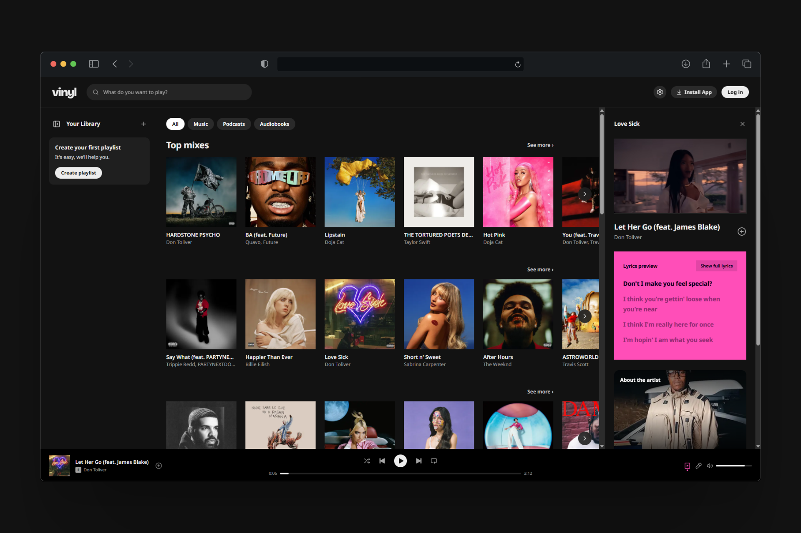

# vinyl

A modern music web app to play your favorite tracks, explore new albums, and create playlists directly in your browser. Lightweight, open source, and built for everyday listening.

You can try [Vinyl](https://vinyl-xi-gilt.vercel.app)

	<picture>
		<source media="(prefers-color-scheme: light)" srcset="docs/assets/vinyl-overview-light.png">
		<source media="(prefers-color-scheme: dark)" srcset="docs/assets/vinyl-overview-dark.png">
		
	</picture>

## Documentation

Read the [Quickstart Guide](docs/translations/en/00-quickstart/README.md) to learn how Vinyl works, explore its architecture, and run the project locally.

## You can also read the full documentation in your preferred language.

[Arabic](docs/translations/ar/00-quickstart/README.md) | [Chinese (Simplified)](docs/translations/zh/00-quickstart/README.md) | [Dutch](docs/translations/nl/00-quickstart/README.md) | [French](docs/translations/fr/00-quickstart/README.md) | [German](docs/translations/de/00-quickstart/README.md) | [Hindi](docs/translations/hi/00-quickstart/README.md) | [Indonesian](docs/translations/id/00-quickstart/README.md) | [Italian](docs/translations/it/00-quickstart/README.md) | [Japanese](docs/translations/ja/00-quickstart/README.md) | [Korean](docs/translations/ko/00-quickstart/README.md) | [Polish](docs/translations/pl/00-quickstart/README.md) | [Portuguese (Brazil)](docs/translations/pt/00-quickstart/README.md) | [Russian](docs/translations/ru/00-quickstart/README.md) | [Spanish](docs/translations/es/00-quickstart/README.md) | [Swedish](docs/translations/sv/00-quickstart/README.md) | [Thai](docs/translations/th/00-quickstart/README.md) | [Turkish](docs/translations/tr/00-quickstart/README.md) | [Ukrainian](docs/translations/uk/00-quickstart/README.md) | [Vietnamese](docs/translations/vi/00-quickstart/README.md)

## Code of Conduct

Please read the [Code Of Conduct](/CODE_OF_CONDUCT.md).

## License

Licensed under the [MIT License](/LICENSE.md).
