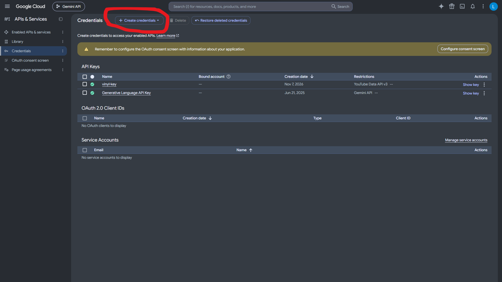

# कॉन्फ़िगरेशन

Vinyl के लिए पर्यावरण चर (Environment Variables) और सेवा एकीकरण सेट करना।

### पर्यावरण सेटअप

रूट फ़ोल्डर में एक `.env` फ़ाइल बनाएं और यह चर जोड़ें:

```env
YOUTUBE_API_KEY=your_youtube_api_key_here
```

#### YouTube API कुंजी प्राप्त करना

1. [Google Cloud Console](https://console.cloud.google.com/) पर जाएँ और **APIs & Services** खोलें।

   

2. बाईं ओर के मेनू में **Library** (लाइब्रेरी) पर क्लिक करें।

   

3. **YouTube Data API v3** खोजें, इसे चुनें और **Enable** (सक्षम करें) पर क्लिक करें।

   

4. API सक्षम होने के बाद, बाईं ओर **Credentials** पर जाएँ, **+ Create Credentials** पर क्लिक करें और **API Key** चुनें।

   

5. **Create API key** पैनल में विकल्प कॉन्फ़िगर करें और **Create** पर क्लिक करें:
   - **Name:** एक पहचान योग्य नाम दर्ज करें (जैसे `vinyl-key`)।
   - **API प्रतिबंध:** **YouTube Data API v3** चुनें।
   - **एप्लिकेशन प्रतिबंध:** **None** (कोई नहीं) पर रखें।

   

6. उत्पन्न API कुंजी को कॉपी करें और अपनी `.env` फ़ाइल में `YOUTUBE_API_KEY` के रूप में सेट करें:

   ```env
   YOUTUBE_API_KEY=your_actual_api_key_here
   ```

> [!TIP]
> Google Cloud, YouTube Data API के लिए एक उदार दैनिक मुफ्त कोटा प्रदान करता है जो व्यक्तिगत उपयोग के लिए पर्याप्त है।

<div align="left">
  <a href="../01-installation/README.md"><strong>← पीछे: संस्थापना</strong></a>
</div>

---

*अस्वीकरण: इस दस्तावेज़ का अनुवाद एक आंतरिक स्वचालित AI प्रक्रिया द्वारा किया गया है और इसमें अशुद्धियां या त्रुटियां हो सकती हैं। अंग्रेजी में मूल दस्तावेज़ ही आधिकारिक संदर्भ स्रोत है।*
