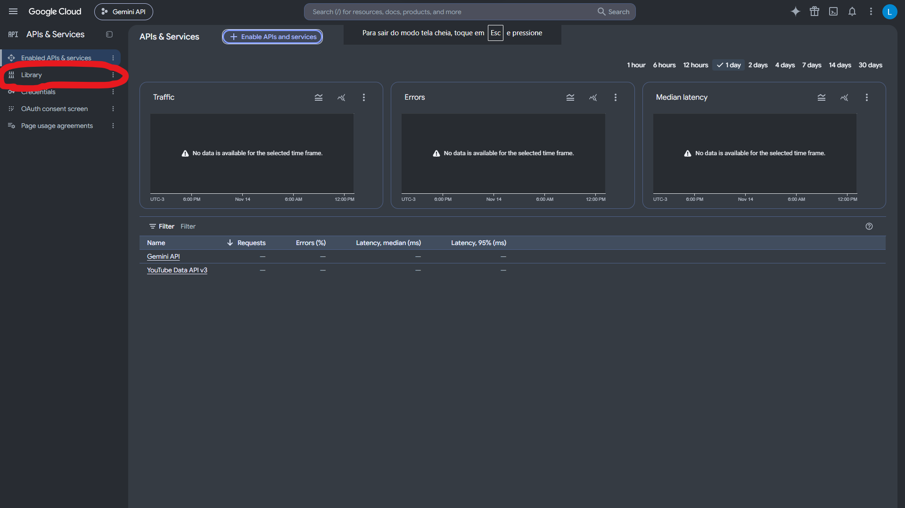

# konfigurasi

Cara mengonfigurasi variabel lingkungan dan integrasi layanan untuk Vinyl.

### Pengaturan Lingkungan

Buat file `.env` di direktori root dan tambahkan variabel ini:

```env
YOUTUBE_API_KEY=your_youtube_api_key_here
```

#### Mendapatkan Kunci API YouTube

1. Buka [Google Cloud Console](https://console.cloud.google.com/) dan masuk ke menu **APIs & Services**.

   

2. Di menu bilah sisi kiri, klik **Library** (Pustaka).

   

3. Cari **YouTube Data API v3**, pilih dari katalog, lalu klik **Enable** (Aktifkan).

   

4. Setelah API aktif, buka **Credentials** di menu kiri, klik **+ Create Credentials**, lalu pilih **API Key**.

   

5. Pada panel **Create API key**, sesuaikan opsi lalu klik **Create**:
   - **Name:** Masukkan nama yang mudah dikenali (misalnya `vinyl-key`).
   - **API restrictions:** Pilih **YouTube Data API v3**.
   - **Application restrictions:** Biarkan tetap **None**.

   

6. Salin kunci yang dibuat dan masukkan ke file `.env` sebagai `YOUTUBE_API_KEY`:

   ```env
   YOUTUBE_API_KEY=your_actual_api_key_here
   ```

> [!TIP]
> Google Cloud menyediakan kuota harian gratis untuk YouTube Data API yang sangat mencukupi untuk pengembangan lokal dan penggunaan pribadi.

<div align="left">
  <a href="../01-installation/README.md"><strong>← Sebelumnya: Instalasi</strong></a>
</div>

---

*Penafian: Dokumen ini diterjemahkan melalui proses otomatisasi AI internal dan mungkin mengandung kesalahan atau ketidakakuratan. Dokumentasi asli dalam bahasa Inggris adalah sumber referensi resmi.*
