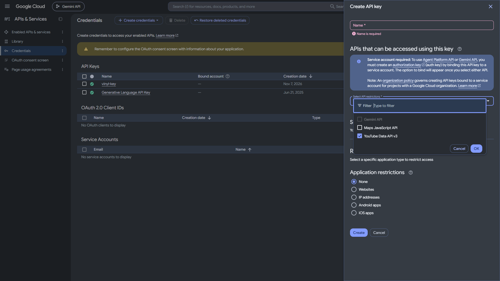

# configuratie

Omgevingsvariabelen en service-integraties instellen voor Vinyl.

### Omgevingsconfiguratie

Maak een `.env`-bestand aan in de hoofdmap en voeg deze variabele toe:

```env
YOUTUBE_API_KEY=your_youtube_api_key_here
```

#### Een YouTube API-sleutel verkrijgen

1. Ga naar de [Google Cloud Console](https://console.cloud.google.com/) en navigeer naar **APIs & Services**.

   

2. Klik in het linkermenu op **Library** (Bibliotheek).

   

3. Zoek naar **YouTube Data API v3**, selecteer deze en klik op **Enable** (Inschakelen).

   

4. Ga na het inschakelen naar **Credentials** in het linkermenu, klik op **+ Create Credentials** en kies **API Key**.

   

5. Stel de opties in het paneel **Create API key** in en klik op **Create**:
   - **Name:** Voer een herkenbare naam in (bijv. `vinyl-key`).
   - **API restrictions:** Selecteer **YouTube Data API v3**.
   - **Application restrictions:** Laat op **None** staan.

   

6. Kopieer de gegenereerde sleutel en wijs deze toe aan `YOUTUBE_API_KEY` in je `.env`-bestand:

   ```env
   YOUTUBE_API_KEY=your_actual_api_key_here
   ```

> [!TIP]
> Google Cloud biedt een gratis dagelijks quotum voor de YouTube Data API dat ruim voldoende is voor lokale ontwikkeling en persoonlijk gebruik.

<div align="left">
  <a href="../01-installation/README.md"><strong>← Vorige: Installatie</strong></a>
</div>

---

*Disclaimer: Dit document is vertaald via een intern geautomatiseerd AI-proces en kan onnauwkeurigheden of fouten bevatten. De originele Engelse documentatie is de officiële referentiebron.*
