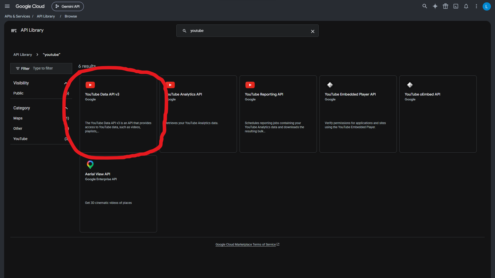

# konfiguracja

Jak skonfigurować zmienne środowiskowe i integracje usług dla Vinyl.

### Konfiguracja środowiska

Utwórz plik `.env` w katalogu głównym projektu i dodaj zmienną:

```env
YOUTUBE_API_KEY=your_youtube_api_key_here
```

#### Uzyskanie klucza YouTube API

1. Przejdź do [Google Cloud Console](https://console.cloud.google.com/) i otwórz **APIs & Services**.

   

2. W menu bocznym po lewej stronie kliknij **Library** (Biblioteka).

   

3. Wyszukaj **YouTube Data API v3**, wybierz z listy i kliknij **Enable** (Włącz).

   

4. Po włączeniu API przejdź do **Credentials** w menu po lewej, kliknij **+ Create Credentials** i wybierz **API Key**.

   

5. W panelu **Create API key** skonfiguruj opcje i kliknij **Create**:
   - **Name:** Wpisz rozpoznawalną nazwę (np. `vinyl-key`).
   - **API restrictions:** Zaznacz **YouTube Data API v3**.
   - **Application restrictions:** Pozostaw jako **None** (Brak).

   

6. Skopiuj wygenerowany klucz i przypisz go do `YOUTUBE_API_KEY` w pliku `.env`:

   ```env
   YOUTUBE_API_KEY=your_actual_api_key_here
   ```

> [!TIP]
> Google Cloud zapewnia bezpłatny dzienny limit dla YouTube Data API, który w zupełności wystarcza do lokalnego programowania i prywatnego użytku.

<div align="left">
  <a href="../01-installation/README.md"><strong>← Wstecz: Instalacja</strong></a>
</div>

---

*Zastrzeżenie prawne: Niniejszy dokument został przetłumaczony w ramach wewnętrznego zautomatyzowanego procesu SI i może zawierać nieścisłości lub błędy. Oficjalnym źródłem odniesienia jest oryginalna dokumentacja w języku angielskim.*
