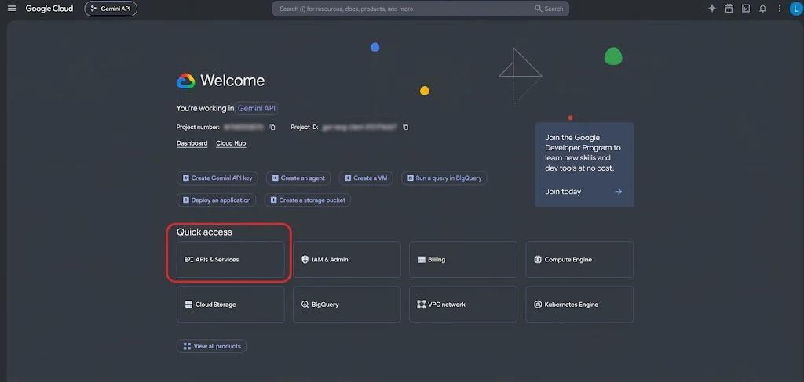

# konfiguration

Så konfigurerar du miljövariabler och tjänster för Vinyl.

### Miljökonfiguration

Skapa en `.env`-fil i rotkatalogen och lägg till denna variabel:

```env
YOUTUBE_API_KEY=your_youtube_api_key_here
```

#### Skaffa en YouTube API-nyckel

1. Gå till [Google Cloud Console](https://console.cloud.google.com/) och navigera till **APIs & Services**.

   

2. Klicka på **Library** (Bibliotek) i den vänstra sidomenyn.

   

3. Sök efter **YouTube Data API v3**, välj det i katalogen och klicka på **Enable** (Aktivera).

   

4. När API:et är aktiverat går du till **Credentials** i menyn, klickar på **+ Create Credentials** och väljer **API Key**.

   

5. Konfigurera alternativen i panelen **Create API key** och klicka på **Create**:
   - **Name:** Ange ett tydligt namn (t.ex. `vinyl-key`).
   - **API restrictions:** Välj **YouTube Data API v3**.
   - **Application restrictions:** Låt stå som **None** (Ingen).

   

6. Kopiera nyckeln och lägg till den som `YOUTUBE_API_KEY` i din `.env`-fil:

   ```env
   YOUTUBE_API_KEY=your_actual_api_key_here
   ```

> [!TIP]
> Google Cloud erbjuder en kostnadsfri daglig kvot för YouTube Data API som räcker gott för lokal utveckling och personligt bruk.

<div align="left">
  <a href="../01-installation/README.md"><strong>← Föregående: Installation</strong></a>
</div>

---

*Friskrivningsklausul: Detta dokument översattes via en intern automatiserad AI-process och kan innehålla felaktigheter eller misstag. Den engelska originaldokumentationen är den officiella referenskällan.*
