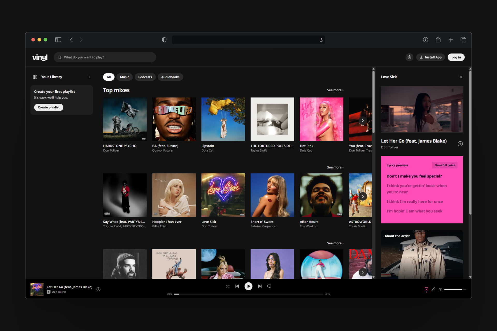

# vinyl

En modern musikwebbapp för att spela dina favoritlåtar, upptäcka nya album och skapa spellistor direkt i webbläsaren. Lättviktig, öppen källkod och skapad för dagligt lyssnande.

	<picture>
		<source media="(prefers-color-scheme: light)" srcset="../../assets/vinyl-overview-light.png">
		<source media="(prefers-color-scheme: dark)" srcset="../../assets/vinyl-overview-dark.png">
		
	</picture>

## Läs hela dokumentationen på andra språk

[English](../../../README.md) | [Portuguese (Brazil)](../pt/README.md) | [Spanish](../es/README.md) | [French](../fr/README.md) | [German](../de/README.md) | [Italian](../it/README.md) | [Russian](../ru/README.md) | [Japanese](../ja/README.md) | [Korean](../ko/README.md) | [Chinese (Simplified)](../zh/README.md) | [Arabic](../ar/README.md) | [Hindi](../hi/README.md) | [Turkish](../tr/README.md) | [Dutch](../nl/README.md) | [Polish](../pl/README.md) | **Swedish** | [Ukrainian](../uk/README.md) | [Indonesian](../id/README.md) | [Thai](../th/README.md) | [Vietnamese](../vi/README.md)

## Uppförandekod

Vänligen läs vår [uppförandekod](../../../CODE_OF_CONDUCT.md).

## Licens

Licensierad under [MIT-licensen](../../../LICENSE.md).

---

*Friskrivningsklausul: Detta dokument översattes via en intern automatiserad AI-process och kan innehålla felaktigheter eller misstag. Den engelska originaldokumentationen är den officiella referenskällan.*
